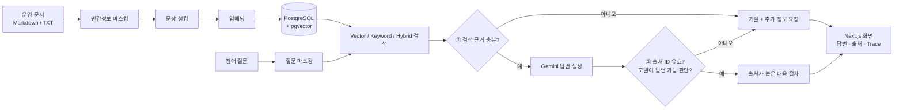

# RAGOps Copilot

[](https://github.com/100bee/rag-ops-copilot/actions/workflows/ci.yml)

**장애가 났을 때 운영 문서에서 근거를 찾아 대응 절차를 알려주고, 근거가 없으면 "모른다"고 답하는 RAG 시스템.**

가상의 B2B AI 서비스 운영팀을 위한 MVP입니다. API 429, 인증 오류, 색인 정체, 느린 검색, 토큰 비용 급증 같은 장애를 다루는 운영 문서 12개를 대상으로 합니다.

## 한눈에 보기

**문서에 근거가 있는 질문 → 출처가 붙은 대응 절차**

> **Q.** OpenAI API 429 오류가 갑자기 증가했어. 재시도는 어떻게 해야 해?
>
> **즉시 확인할 항목**
> - 오류 응답의 request ID와 발생 시각을 확보한다. `[S1]`
> - 클라이언트가 429 응답을 즉시 반복 호출하고 있지 않은지 확인한다. `[S1]`
>
> **대응 절차**
> - 재시도는 지수 백오프와 jitter를 적용하고 최대 횟수를 제한한다. `[S1]`
> - 동일 질문의 중복 요청은 idempotency key 또는 짧은 캐시로 합친다. `[S1]`
>
> `S1` = `api-429-rate-limit-runbook.md`

**문서에 근거가 없는 질문 → 추측하지 않고 거절**

> **Q.** OpenAI API 429 오류 당시 고객사별 실제 피해 금액과 보상 승인자를 알려줘
>
> **근거 부족.** 현재 등록된 운영 문서에서는 이 질문을 뒷받침할 충분한 근거를 찾지 못했습니다. 오류 발생 시각과 요청 ID, 영향을 받은 서비스와 배포 버전을 확보한 뒤 담당 팀에 확인하세요.

*두 예시는 실제 Gemini 실행 결과를 줄인 것입니다.*


*실제 실행 화면. 왼쪽에서 문서를 관리하고, 가운데에서 질문하며, 오른쪽에서 검색 근거와 실행 정보(점수·지연시간·토큰·Trace)를 확인합니다.*

## 이 프로젝트에서 한 일

| | 내용 |
| --- | --- |
| **1. 세 가지 검색 방식 비교** | 에러 코드를 잘 찾는 Keyword, 다른 표현도 찾는 Vector(pgvector), 둘을 섞은 Hybrid를 같은 문서·질문으로 비교했습니다. |
| **2. 두 단계 거절** | ① 검색 단계: 근거가 약하면 모델을 호출하지 않고 거절합니다. ② 답변 단계: 모델이 문장마다 출처 ID를 달아야 하고, 없는 출처를 인용하거나 모델이 답할 수 없다고 판단하면 거절합니다. |
| **3. 측정하고 기록** | 질문 20개(답변 가능 15·거절 대상 5)로 검색 정확도와 거절 성공률을 측정하고, 실패 사례와 한계까지 문서로 남겼습니다. |
| **4. 운영 데이터 보호** | API 키·이메일·IP·토큰을 저장·임베딩 전에 마스킹합니다. 같은 문서는 다시 색인하지 않고, 임베딩 모델이 바뀌면 재색인을 요구합니다. |

## 결과

| 방식 | 정답 문서 검색 (Recall@5) | 정답 순위 (MRR) | 거절 대상 거절 | 답변 가능 질문 잘못 거절 |
| --- | ---: | ---: | ---: | ---: |
| **Vector** | **100%** | **1.000** | 3/5 | 0/15 |
| Keyword | 93.3% | 0.817 | 4/5 | 3/15 |
| Hybrid | 100% | 0.878 | 3/5 | 0/15 |

`gemini-embedding-001` 기준, 문서 12개·질문 20개, 방식별 1회 실행. Recall·MRR은 답변 가능한 15문항으로 계산합니다.

**알게 된 것**

- **의미 검색이 표현 차이를 메웠습니다.** "파일을 올린 뒤 오랫동안 처리 중이라고만 나와"라는 질문에서 Vector는 Worker 정체 문서를 1위로 찾았고, Keyword는 놓쳤습니다.
- **Hybrid가 항상 낫지는 않았습니다.** 현재 가중치(Vector 0.72 / Keyword 0.28)에서는 키워드 점수가 의미 검색 순위를 오히려 낮추기도 했습니다.
- **거절 기준을 측정으로 고쳤습니다.** Gemini 임베딩은 무관한 질문에도 유사도 약 0.54를 줘서, 처음 기준(0.35)에서는 거절 대상 5개를 모두 통과시켰습니다(0/5). dev 질문만 보고 기준을 0.62로 보정하자 3/5를 거절했고, 답변 가능 질문의 잘못된 거절은 0건을 유지했습니다.
- **유사도만으로는 부족합니다.** 남은 2문항(문서에 없는 피해 금액, 관리자 개인정보)은 주제가 같아 유사도로 구분되지 않았습니다. 이 둘은 실제 호출에서 답변 단계의 Gemini가 거절했습니다.

자세한 과정: [거절 기준 보정 실험(v3)](docs/retrieval-experiment-v3-gemini-calibrated.md) · [원본 JSON](docs/retrieval-experiment-v3-gemini-calibrated.json) · [이전 실험·실패 분석(v2)](docs/retrieval-experiment-v2-gemini-budget.md)

## 동작 방식



| 기술 | 쓰임 |
| --- | --- |
| FastAPI · SQLAlchemy | 문서 수집, 검색, 답변, 평가 API |
| PostgreSQL 16 · pgvector | 문서·벡터·Trace를 한 DB에서 관리, 벡터 검색과 키워드 검색 |
| Gemini (`gemini-3.5-flash-lite`, `gemini-embedding-001`) | 답변 생성(JSON Schema 구조화 응답)과 1536차원 의미 임베딩 |
| LlamaIndex Core | `SentenceSplitter` 문장 단위 청킹 |
| Next.js 16 · React 19 · TypeScript | 질문, 검색 후보, 출처, 진단 정보를 한 화면에 표시 |
| Docker Compose · GitHub Actions | 실행·테스트 환경 재현, CI에서 테스트와 평가 실행 |

OpenAI(`gpt-5-mini`, `text-embedding-3-small`) 연동 코드도 있지만 실제 호출로는 검증하지 않았습니다. 모델을 학습하거나 파인튜닝하지 않습니다.

## 실행하기

Docker Desktop과 Google AI Studio API 키가 필요합니다. 키 발급과 무료 등급 제한은 [Gemini 설정 안내](docs/gemini-setup.md)를 참고하세요.

```bash
git clone https://github.com/100bee/rag-ops-copilot.git
cd rag-ops-copilot
test -f .env || cp .env.example .env
```

`.env`에 다음을 입력합니다. 실제 키는 `.env.example`이나 프론트엔드에 넣지 않습니다.

```env
AI_PROVIDER=gemini
GEMINI_API_KEY=발급받은_키
GEMINI_CHAT_MODEL=gemini-3.5-flash-lite
GEMINI_EMBEDDING_MODEL=gemini-embedding-001
```

```bash
docker compose up --build -d --wait
```

1. [웹 화면](http://localhost:3000)을 엽니다. [API 문서](http://localhost:8000/docs)도 있습니다.
2. **샘플 문서 색인**을 눌러 문서 12개를 등록합니다.
3. `OpenAI API 429 오류가 갑자기 증가했어. 재시도는 어떻게 해야 해?`를 입력합니다.
4. 검색 방식을 바꿔 보며 출처·점수·Trace를 비교합니다.

Windows PowerShell에서는 `.env` 생성에 `if (!(Test-Path .env)) { Copy-Item .env.example .env }`를 사용합니다. 포트는 기본적으로 `127.0.0.1`에만 열립니다. provider나 임베딩 모델을 바꾸면 문서를 다시 색인해야 합니다.

## 평가와 테스트

```bash
# Gemini로 색인된 환경에서 20문항 검색 평가 (질문마다 임베딩 1회, 답변 생성 호출 없음)
docker compose exec -T backend python -m app.evaluate --repetitions 1 --reuse-query-embeddings > docs/my-gemini-retrieval.json
```

- 단위·PostgreSQL 통합 테스트 **25개**: 마스킹, 중복 업로드, 모델 변경 시 재색인, 잘못된 출처 거절, 근거가 없을 때 모델 미호출 등을 검사합니다.
- [CI](.github/workflows/ci.yml)는 외부 AI 호출 없이 앱을 빌드하고, 격리된 PostgreSQL로 테스트를 돌린 뒤 평가 JSON을 아티팩트로 남깁니다.
- API 데모 스크립트: macOS/Linux `bash scripts/demo.sh`, Windows `scripts/demo.ps1`.

<details>
<summary><b>핵심 설계 선택</b></summary>

| 결정 | 이유 |
| --- | --- |
| 세 검색 방식을 독립적으로 유지 | "Hybrid가 더 좋다"는 가정을 같은 데이터로 검증하기 위해 |
| 검색 점수와 답변 허용 판정 분리 | 순위가 높다고 해서 질문에 답할 근거가 있는 것은 아니므로 |
| 주장마다 출처 ID 요구 | 없는 ID, 출처 없는 주장, 잘못된 응답 형식을 거절. 인용 내용의 사실성 검증은 별도 과제 |
| 저장·임베딩 전에 마스킹 | API 키, 이메일, IPv4, Bearer 토큰이 DB나 외부 API로 나가지 않도록 |
| checksum + 임베딩 설정 식별 | 중복 색인은 건너뛰고, provider·모델·차원이 바뀌면 같은 문서도 재색인 |
| provider별 거절 기준 | 임베딩 모델마다 유사도 분포가 달라 하나의 기준을 공유할 수 없음 |

</details>

## 한계와 다음 단계

실제 사용자가 있는 서비스에서 성과(장애 대응 시간 단축 등)를 측정한 프로젝트는 아닙니다.

- **데이터가 작습니다.** 가상 문서 12개, 질문 20개입니다. Gemini 거절 기준 0.62는 dev 거절 대상 2문항으로 정했고, challenge 질문은 이미 분석에 공개된 질문입니다. 처음 보는 질문을 추가해 다시 확인해야 합니다.
- **답변의 사실 정확도는 채점하지 않았습니다.** 출처 ID 검증은 인용이 주장 전체를 뒷받침한다는 증명이 아닙니다. 답변 단계 거절은 2건만 확인했습니다.
- **응답이 느립니다.** 정상 답변 1건 생성에 약 36초가 걸렸습니다. 스트리밍과 컨텍스트 예산 조정이 필요합니다.
- **규모 확장 전 작업:** 벡터 인덱스(HNSW)와 전문검색 인덱스, 인증·문서 권한, 작업 큐가 아직 없습니다.
- **마스킹은 정규식 기반**이라 모든 민감정보를 탐지하지 못합니다.

## 문서

| 문서 | 내용 |
| --- | --- |
| [도메인 정의](docs/project-brief.md) | 가상 운영 환경, 대상 사용자, MVP 범위 |
| [아키텍처](docs/architecture.md) | 데이터 흐름, 저장 구조, 근거 제한과 모델 전환 |
| [모델 상세](docs/models.md) | 사용 모델, 역할, 설정, API 호출 흐름, 검증 범위 |
| [구현 가이드](docs/implementation-guide.md) | 여덟 단계 구현 순서와 단계별 확인 기준 |
| [Gemini 설정](docs/gemini-setup.md) | 키 발급, 무료 등급 확인, 설정·오류 처리 |
| [검증 기록](docs/validation-2026-09-04.md) | 실제 실행 결과와 검증의 한계 |
