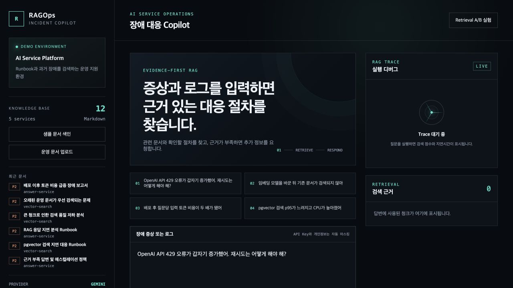
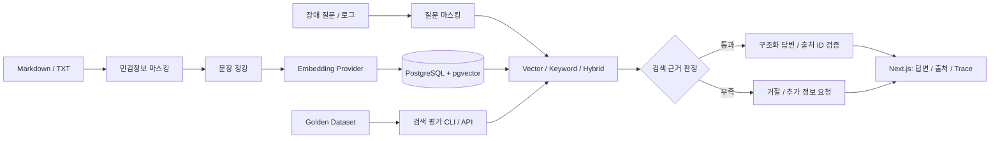

# RAGOps Copilot

[](https://github.com/100bee/rag-ops-copilot/actions/workflows/ci.yml)

**운영 장애 문서를 검색하고, 출처가 있는 대응 절차를 제안하는 RAG 설계·평가 프로젝트.**

API 429, 문서 색인 정체, 검색 품질 저하, 응답 지연과 토큰 증가를 다룹니다. FastAPI·pgvector로 검색 파이프라인을 구현하고, Next.js에서 답변 출처와 실행 과정을 확인합니다. 가상의 B2B AI 서비스 운영팀을 대상으로 한 MVP입니다.

[사용 모델 상세](docs/models.md) · [아키텍처](docs/architecture.md) · [Gemini 실험](docs/retrieval-experiment-v2-gemini-budget.md) · [구현 가이드](docs/implementation-guide.md)



*실제 실행 화면. 왼쪽에서 문서를 관리하고, 가운데에서 질문하며, 오른쪽에서 검색 근거와 실행 정보를 확인합니다. 이미지는 질문 실행 전 상태입니다.*

## 해결하려는 문제

장애 대응에는 증상에 맞는 문서를 찾는 것뿐 아니라, 문서가 실제로 그 질문에 답할 수 있는지 판단하는 과정이 필요합니다. 이 프로젝트는 다음 세 가지를 함께 구현하고 검증합니다.

- **검색:** 에러 코드와 기술 용어를 찾는 Keyword, 표현이 다른 질문을 찾는 Vector, 두 방식을 결합한 Hybrid를 비교합니다.
- **근거 제한:** 검색 결과를 근거로 사용하고, 충분하지 않으면 거절합니다. 모델 응답의 형식과 출처 ID도 검증합니다.
- **평가와 관측:** 정답 문서 검색률, 순위, 답변 허용 판정, 지연시간과 토큰을 기록해 실패 원인을 확인합니다.

## 구현 범위와 검증 결과

| 항목 | 구현 및 확인 내용 |
| --- | --- |
| 도메인 데이터 | Runbook·장애 회고·정책 12개, 질문 20개: 답변 가능 15개·거절 대상 5개 |
| 문서 처리 | Markdown/TXT 업로드, 마스킹, 문장 청킹, 임베딩, checksum 중복 방지·재색인 |
| 검색 | pgvector 코사인 검색 / PostgreSQL 키워드 검색 / 가중치 기반 Hybrid |
| 답변 | 구조화된 한국어 대응 절차, 출처 ID 검증, 근거 부족·모델 거절 처리 |
| 관측성 | 검색 후보·점수·단어 일치 비율, 검색/생성 지연, 모델·프롬프트, 토큰·Trace |
| 실험 | Gemini 임베딩 20문항 × Vector·Keyword·Hybrid 방식별 1회 |
| 검증 | 단위·PostgreSQL 통합 테스트 23개 통과, Next.js 프로덕션 빌드, 실제 Gemini 답변·거절 확인 |

실제 사용자가 있는 프로덕션 서비스의 성과나 장애 대응 시간 단축을 측정한 프로젝트는 아닙니다. [검증 기록](docs/validation-2026-09-04.md)과 [실험 원본](docs/retrieval-experiment-v2-gemini-budget.json)을 함께 공개합니다.

## 사용 모델

검색용 임베딩과 답변 생성은 서로 다른 모델을 사용합니다. 아래는 저장소 기본 설정과 실제 검증 범위입니다.

| 역할 | 모델·방식 | 프로젝트 설정 | 검증 범위 |
| --- | --- | --- | --- |
| **실제 답변 생성** | Google `gemini-3.5-flash-lite` | `generateContent`, JSON Schema, 출력 최대 2,048토큰, 요청 timeout 45초 | 실제 정상 답변·근거 부족 거절 확인 |
| **실제 의미 검색** | Google `gemini-embedding-001` | 1536차원, L2 정규화, 문서/질문 task type 분리 | 문서 12개 색인 및 20문항 검색 비교 |
| 선택적 OpenAI 생성 | `gpt-5-mini` | Responses API, Pydantic 구조화 응답, `store=False` | 연동 코드·모의 응답 테스트; 실제 호출 미검증 |
| 선택적 OpenAI 임베딩 | `text-embedding-3-small` | 1536차원 | 연동 구현; 실제 색인·검색 실험 미수행 |

모델을 학습하거나 파인튜닝하지 않습니다. Gemini 검색 실험에는 답변 모델을 호출하지 않았습니다. 선택 이유, 프롬프트와 응답 검증, 토큰 집계, 모델 변경 시 재색인 정책은 [모델 상세 문서](docs/models.md)에 설명합니다.

## 아키텍처



| 기술 | 적용 이유 |
| --- | --- |
| FastAPI · SQLAlchemy | 문서 수집, 검색, 답변, 평가 API와 DB 트랜잭션 구현 |
| PostgreSQL 16 · pgvector | 문서 메타데이터·벡터·Trace를 한 DB에서 관리하고 키워드 검색과 비교 |
| LlamaIndex Core | `SentenceSplitter`를 사용한 문장 단위 청킹 |
| Next.js 16 · React 19 · TypeScript | 질문과 검색 후보, 출처, 진단 정보를 한 화면에 표시 |
| Docker Compose · GitHub Actions | 실행·테스트 환경 재현, 평가 JSON 아티팩트 생성 |

## 핵심 설계 선택

| 결정 | 이유와 적용 범위 |
| --- | --- |
| 세 검색 방식을 독립적으로 유지 | Hybrid가 더 좋다는 가정을 실험으로 검증하기 위해 같은 문서·질문으로 비교 |
| 검색 점수와 답변 허용 판정 분리 | 높은 유사도나 상대 순위만으로 질문에 답할 근거가 있다고 판단할 수 없음 |
| 주장마다 출처 ID 요구 | 없는 ID·출처 없는 주장·잘못된 응답 형식을 거절. 인용 내용의 사실성 검증은 별도 과제 |
| 저장·임베딩 전에 마스킹 | API 키, 이메일, IPv4, Bearer 토큰 등을 정규식·설정 키 매칭으로 처리 |
| checksum + 임베딩 설정 식별 | 중복 색인은 건너뛰고, provider·모델·차원이 바뀌면 같은 문서도 재색인 |
| 질문 임베딩을 실험 안에서 재사용 | Vector/Hybrid가 같은 질문을 중복 임베딩하지 않도록 하고 준비 시간을 별도 기록 |

세부 데이터 흐름은 [아키텍처](docs/architecture.md), 모델별 역할과 설정은 [사용 모델 상세](docs/models.md)를 참고하세요.

## 검색 비교: 결과와 실패를 함께 기록

같은 문서 12개와 질문 20개를 사용했습니다. Recall@5·MRR은 답변 가능한 15문항, 근거 판정 일치율은 전체 20문항을 대상으로 합니다. 복수 정답 문서는 Recall에서 각각 반영합니다.

| 임베딩 | 방식 | Recall@5 | MRR | 검색 근거 판정 일치율 |
| --- | --- | ---: | ---: | ---: |
| **Gemini** | **Vector** | **100.0%** | **1.000** | **75.0%** |
| Gemini | Keyword | 93.3% | 0.817 | 80.0% |
| Gemini | Hybrid | 100.0% | 0.878 | 75.0% |

**이번 작은 데이터에서는 Gemini Vector의 검색 순위가 가장 좋았습니다.** 반면 Vector·Hybrid의 현재 검색 근거 판정은 거절 대상 5문항을 모두 잘못 허용했습니다. 75%라는 전체 일치율이 거절 성능이 좋다는 뜻은 아닙니다. Keyword도 답변 가능한 3문항을 잘못 거절했습니다.

- **의미 검색의 효과:** “파일을 올린 뒤 오랫동안 처리 중…” 질문에서 Vector는 Worker 정체 문서를 1위로 찾았고, Keyword는 놓쳤습니다.
- **Hybrid의 한계:** 같은 질문의 정답 문서는 Hybrid에서 3위였습니다. 현재 가중치의 키워드 결합이 의미 검색 순위를 낮추기도 했습니다.
- **다음 개선점:** 검색 순위와 별개로 거절 기준을 보정하고, 새 검증 질문과 생성 답변의 수동 근거 대조로 확인해야 합니다.

Gemini 실험은 질문 20개·750자를 **동기 임베딩 배치 1회**로 처리했습니다. 기존 색인을 사용했고 답변 생성 호출은 0회였습니다. 문자는 토큰과 다르며 정확한 임베딩 토큰 사용량은 해당 실행에서 수집하지 않았습니다.

검색 방식별 1회 실행했으며 임베딩 준비 시간은 DB 검색시간과 분리했습니다. 작은 데이터의 검색 평가 결과로, 전체 생성 답변의 사실 정확도를 채점한 결과는 아닙니다.

[Gemini 실험·실패 분석](docs/retrieval-experiment-v2-gemini-budget.md) · [Gemini 원본 JSON](docs/retrieval-experiment-v2-gemini-budget.json)

## 실행하기

Docker Desktop과 Google AI Studio API 키를 준비합니다. 무료 등급의 모델·프로젝트별 제한과 키 발급 방법은 [Gemini 설정 안내](docs/gemini-setup.md)에 설명되어 있습니다.

```bash
git clone https://github.com/100bee/rag-ops-copilot.git
cd rag-ops-copilot
test -f .env || cp .env.example .env
```

서버 설정 파일 `.env`에서 다음 항목을 입력합니다. 실제 키는 `.env.example`이나 프론트엔드에 넣지 않습니다.

```env
AI_PROVIDER=gemini
GEMINI_API_KEY=발급받은_키
GEMINI_CHAT_MODEL=gemini-3.5-flash-lite
GEMINI_EMBEDDING_MODEL=gemini-embedding-001
```

```bash
docker compose up --build -d --wait
```

Windows PowerShell에서는 환경파일 생성에 `if (!(Test-Path .env)) { Copy-Item .env.example .env }`를 사용합니다.

1. [웹 화면](http://localhost:3000)을 엽니다. [API 문서](http://localhost:8000/docs)도 제공됩니다.
2. **샘플 문서 색인**을 눌러 문서 12개를 등록합니다.
3. `OpenAI API 429 오류가 갑자기 증가했어. 재시도는 어떻게 해야 해?`를 입력합니다.
4. 검색 방식을 바꾸고 출처·검색 점수·Trace를 확인합니다.

서비스 포트는 기본적으로 `127.0.0.1`에만 노출합니다. provider·임베딩 모델을 변경하면 문서를 다시 색인해야 합니다. 포트 변경과 환경변수 반영은 [구현 가이드](docs/implementation-guide.md)를 참고하세요.

## 평가 재현과 테스트

```bash
# Gemini로 이미 색인한 환경에서 질문 벡터를 공유하는 소규모 검색 평가
docker compose exec -T backend python -m app.evaluate --repetitions 1 --reuse-query-embeddings > docs/my-gemini-retrieval.json
```

문서는 재색인하지 않고 질문마다 한 번만 임베딩합니다. 답변 생성 API는 호출하지 않습니다. 실행 중인 provider는 [상태 API](http://localhost:8000/api/health)에서 확인합니다. 웹의 **Retrieval A/B 실험**도 검색을 비교하며 임베딩 API를 사용합니다.

[CI 워크플로](.github/workflows/ci.yml)는 외부 AI 호출 없이 앱을 빌드하고, 격리된 PostgreSQL DB로 전체 테스트를 실행하며, 테스트용 검색 평가 JSON을 아티팩트로 남기도록 구성했습니다. Python·npm 의존성은 잠금 파일로 고정했습니다. API 데모 스크립트는 macOS/Linux의 `bash scripts/demo.sh`, Windows의 `scripts/demo.ps1`입니다.

## 현재 한계와 다음 단계

- **데이터와 평가:** 가상 문서 12개·질문 20개의 작은 데이터입니다. 이미 살펴본 challenge 질문을 계속 독립 시험 세트로 주장하지 않고 새 질문을 추가해야 합니다.
- **근거 판정:** 의미 유사도 기준 0.35에서 답이 없는 질문을 허용하는 실패가 있습니다. 출처 ID 검증만으로 문장의 사실 정확성을 보장하지 않습니다.
- **응답 속도:** 실제 정상 Gemini 답변 1건의 생성에 약 36초가 걸렸습니다. 스트리밍·컨텍스트 예산·구간별 지연을 추가 검토할 여지가 있습니다.
- **서비스 범위:** 인증·조직별 문서 권한, 작업 큐, OCR, 외부 모니터링·자동 복구는 후속 범위입니다.
- **운영 데이터 보호:** 마스킹은 정규식 기반이라 모든 민감정보를 탐지하지 않습니다. 과거 저장 데이터는 소급 삭제하지 않으며, 문서 재색인과 별도 보존 정책이 필요합니다.

## 문서 안내

| 문서 | 내용 |
| --- | --- |
| [모델 상세](docs/models.md) | 실제 사용 모델, 역할, 설정, API 호출 흐름, 검증 범위 |
| [아키텍처](docs/architecture.md) | 데이터 흐름, 저장 구조, 근거 제한과 모델 전환 |
| [도메인 정의](docs/project-brief.md) | 가상 운영 환경, 대상 사용자, MVP 범위 |
| [여덟 단계 구현 가이드](docs/implementation-guide.md) | 구현 순서와 단계별 확인 기준 |
| [Gemini 설정](docs/gemini-setup.md) | 키 발급, 무료 등급 확인, 설정·오류 처리 |
| [검증 기록](docs/validation-2026-09-04.md) | 실제 실행 결과와 검증의 한계 |
