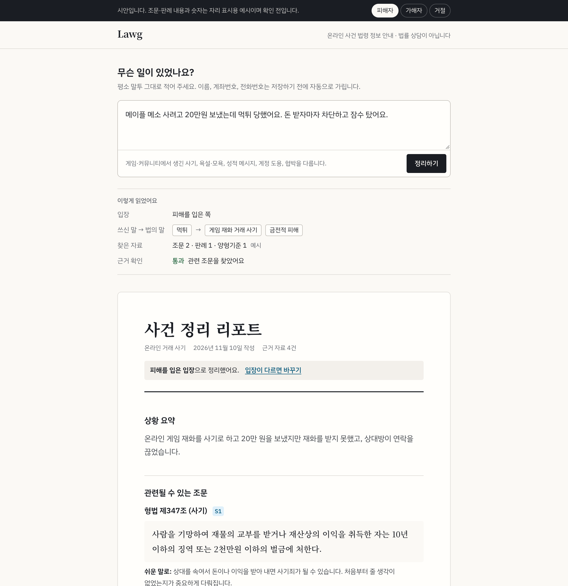
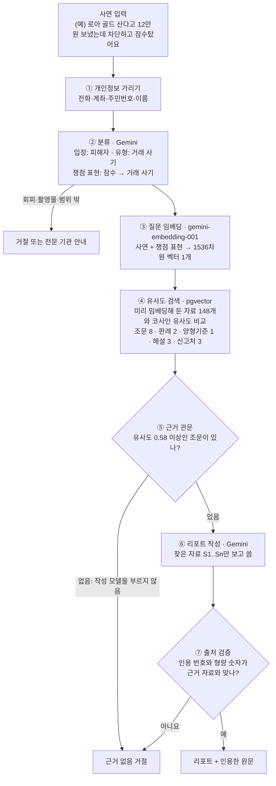

# Lawg

**게임·커뮤니티 이용자를 위한 온라인 사건 법령 안내.**

평소 말투로 적은 사건("먹튀 당했어요", "귓말로 욕했다가 신고당했어요")을 법률 쟁점으로 바꿔 관련 조문을 찾고, 근거가 있을 때만 사건 정리 리포트를 씁니다. 피해자·가해자·주변인 모두 쓸 수 있고, 신고나 상담 전에 들고 갈 정리본을 만드는 것이 목표입니다. 법률 상담이 아니라 법령 정보 안내이며, 개별 사건의 결론은 내리지 않습니다.

> **지금 상태: 개발 중.** 현행 조문 78개, 대표 판례 35건, 양형기준 7개, 안내 자료 28개로 사건 입력부터 리포트까지 동작합니다. 자료 목록과 평가셋은 아직 검토 중입니다. 아래 화면은 시안이며 조문·판례 내용과 숫자는 예시입니다.

*[시안 HTML](docs/mockup/index.html)을 내려받아 브라우저로 열면 피해자·가해자·거절 화면을 바꿔 볼 수 있습니다.*

## 다루는 사건 (1차)

| 유형 | 예시 입력 |
| --- | --- |
| 게임머니·아이템·계정 거래 사기 | "돈 보냈는데 먹튀 당했어요" |
| 온라인 모욕·명예훼손 | "게임에서 욕했는데 고소당했어요" |
| 통신매체이용음란(통매음) | "귓말로 성적인 욕을 했다가 신고당했어요" |
| 계정 도용·해킹 | "계정이 털렸어요" |
| 협박·스토킹 | "신상 턴다고 협박해요" |

- 불법 촬영물 유포 등은 리포트를 만들지 않고 전문 지원 기관을 바로 안내합니다.
- 사이버 사건이 아닌 질문(교통사고, 이혼 등)은 범위 밖으로 거절합니다.
- 개별 사건의 결론, 합의금, 처벌을 피하는 방법은 답하지 않습니다.

## 리포트 구성

1. 상황 요약
2. 관련될 수 있는 조문: 원문, 쉬운 풀이, 출처 ID
3. 처벌 범위 참고: 조문의 법정형, 양형기준의 권고 범위
4. 확인이 필요한 사실
5. 지금 할 수 있는 일
6. 준비할 것
7. 이 도구가 답하지 못하는 것

## 동작 방식

| 단계 | 하는 일 | 기술 |
| --- | --- | --- |
| 색인 (미리 한 번) | 조문·판례·양형기준·해설 148개를 자료 1개 = 청크 1개로 두고, 본문을 벡터로 바꿔 저장. 판례는 판결요지(없으면 판시사항)를 임베딩 | `gemini-embedding-001` (1536차원), PostgreSQL + pgvector |
| ① 가리기 | 저장하거나 모델에 보내기 전에 전화·계좌·주민번호와 "이름은 OOO" 같은 이름을 가림 | 정규식 |
| ② 분류 | 입장(피해자·가해자·주변인)·사건 유형·요청을 고르고, "먹튀"·"잠수" 같은 말을 법률 쟁점 표현으로 바꿈. 회피 요청, 촬영물, 범위 밖은 여기서 거절 | Gemini `gemini-3.5-flash-lite`, JSON 스키마 응답 |
| ③ 임베딩 | 가린 사연에 쟁점 표현을 붙여, 색인과 같은 모델로 벡터 1개를 만듦 | `gemini-embedding-001` |
| ④ 유사도 검색 | 질문 벡터와 자료 벡터의 코사인 유사도를 계산해 **종류별로 따로** 상위 N개를 가져옴. 관련 판례는 판결요지가 사연과 가장 비슷한 2건. 양형기준·신고처는 사건 유형으로 먼저 거름 | pgvector 코사인 거리 (`<=>`) |
| ⑤ 근거 관문 | 유사도 0.58 이상인 조문이 하나도 없으면 리포트를 쓰지 않음 | |
| ⑥ 작성 | 찾은 자료만 S1..Sn 번호로 넘기고, 모델은 요약·쉬운 풀이·확인할 사실·할 일을 씀. 주장마다 출처 번호를 붙임 | Gemini, JSON 스키마 응답 |
| ⑦ 검증 | 없는 번호 인용, 출처 없는 형량 숫자는 거절. 조문 원문은 모델이 쓴 글이 아니라 색인된 문서를 그대로 보여 줌. 인용한 출처만 응답에 남김 | |

**왜 이렇게 했나**

- **쟁점 변환:** "입금 확인되자마자 차단 박고 잠수탔어요"에는 "사기"라는 말이 없습니다. 쟁점 표현을 붙이자 정답 조문이 근거 관문을 넘는 비율이 0.79에서 0.93으로 올랐습니다(dev).
- **종류별 검색:** 자료를 19개에서 148개로 늘렸을 때 한 순위로 섞어 찾자, 말투가 사연과 비슷한 판례·해설이 짧은 조문을 밀어내 재현율이 0.93에서 0.19로 떨어졌습니다.
- **벡터 검색만 사용:** 키워드 검색(PostgreSQL 전문 검색)은 한국어 조사를 떼지 못해 거의 맞지 않았고, 섞어 쓰면(Hybrid) 오히려 낮았습니다(dev 재현율 Vector 0.951 · Hybrid 0.932 · Keyword 0.016). 세 방식 모두 실험 CLI로 비교할 수 있습니다.
- **두 단계 거절:** 근거가 없으면 모델을 아예 부르지 않고, 작성 단계에서 모델이 거절해도 그대로 따릅니다.

단계별 세부 규칙과 알려진 한계는 [docs/how-it-works.md](docs/how-it-works.md), 실험 숫자는 [docs/experiments.md](docs/experiments.md)에 있습니다.

FastAPI · SQLAlchemy · PostgreSQL 16 · pgvector · Gemini (`gemini-3.5-flash-lite`, `gemini-embedding-001`) · Next.js · Docker Compose · GitHub Actions

## 진행 상황

| 단계 | 상태 |
| --- | --- |
| 검색·거절 엔진 | 완료. 검색 방식과 거절 기준은 평가셋 초안 dev로 정함 (test 측정은 평가셋 확정 후) |
| 모델 사전 시험 | 완료. Gemini Flash-Lite 무료 등급에서 욕설·성적 표현이 든 입력도 차단 없이 처리 |
| 법령·판례 수집 | 조문 78개 · 판례 35건(판결요지, 전원합의체는 다수의견만) · 양형기준 7개(『2026 양형기준』) · 안내 28개(법제처 찾기 쉬운 생활법령정보 25개 포함). 모두 공식 원문 그대로 |
| 리포트 화면 | 동작 (입력 → 쟁점 변환 → 리포트 · 거절) |

실행하려면 `.env`에 Gemini 키를 넣고 `docker compose up --build -d --wait`로 띄운 뒤 `POST /api/documents/seed`로 근거 자료를 색인합니다. 자세한 실행 방법은 평가를 마친 뒤 정리합니다.

