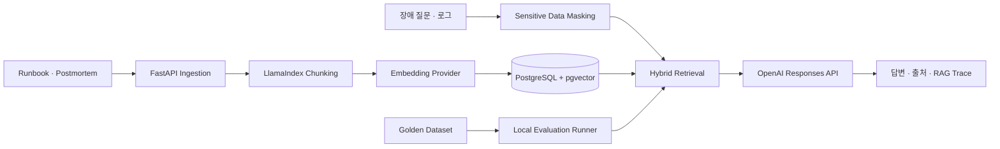

# RAGOps Copilot

AI 서비스 운영 중 발생하는 API 오류, 문서 색인 실패, 검색 품질 저하, 응답 지연과 비용 증가를 Runbook과 과거 장애 기록에서 검색해 근거 있는 대응 절차를 제시하는 RAG 웹서비스입니다.


## 해결하려는 문제

가상의 B2B RAG 플랫폼 운영팀은 Runbook, 장애 보고서, 품질 보고서와 변경 이력이 흩어져 있어 장애 초기 분석에 시간이 걸립니다. RAGOps Copilot은 증상 또는 마스킹된 로그를 입력받아 관련 근거를 검색하고 다음 결과를 제공합니다.

- 장애 요약과 원인 후보
- 즉시 확인할 체크리스트
- 권장 대응 절차
- 유사한 과거 장애와 원문 출처
- 근거가 부족할 때 필요한 추가 정보
- 검색 점수, 지연시간, 토큰 사용량과 실행 Trace

## 주요 특징

- `LlamaIndex SentenceSplitter` 기반 문서 청킹
- OpenAI Embeddings 또는 API 키 없는 로컬 feature hashing 임베딩
- pgvector 코사인 검색과 PostgreSQL 키워드 검색 결합
- 벡터·키워드 점수를 분리해 보여주는 RAG 디버그 화면
- OpenAI Responses API 기반 근거 제한 답변
- API Key, 이메일, IP, Bearer Token 마스킹
- Golden Dataset 기반 `Recall@5`, `MRR`, 거절 정확도 측정
- Markdown/TXT 문서 업로드와 checksum 중복 방지

## 아키텍처



자세한 설계는 `docs/architecture.md`, 프로젝트 범위는 `docs/project-brief.md`에서 확인할 수 있습니다.

## 기술 스택

| 영역 | 기술 |
| --- | --- |
| Frontend | Next.js 16, React 19, TypeScript |
| Backend | FastAPI, SQLAlchemy, Pydantic |
| RAG | LlamaIndex Core, Hybrid Retrieval |
| AI | OpenAI Responses API, Embeddings API |
| Database | PostgreSQL 16, pgvector |
| Infra | Docker Compose |
| Evaluation | JSONL Golden Dataset, local evaluator |

## 빠른 실행

### 1. 환경파일 준비

예제 환경파일을 복사해 로컬 설정을 준비합니다. 기본값은 API 키 없이 실행되는 로컬 모드입니다.

```powershell
Copy-Item .env.example .env
```

OpenAI API를 사용하려면 생성된 `.env`에서 다음 값을 변경합니다.

```env
AI_PROVIDER=openai
OPENAI_API_KEY=your-api-key
OPENAI_CHAT_MODEL=gpt-5.6-luna
OPENAI_EMBEDDING_MODEL=text-embedding-3-small
```

로컬과 OpenAI 임베딩은 서로 다른 벡터 공간을 사용하므로 provider 또는 임베딩 모델을 변경한 뒤에는 DB 볼륨을 초기화하고 다시 색인해야 합니다.

### 2. 서비스 실행

```powershell
docker compose up --build -d
```

### 3. 샘플 색인과 평가

웹에서 `샘플 문서 색인`을 누르거나 다음 스크립트를 실행합니다.

```powershell
.\scripts\demo.ps1
```

### 4. 접속

- Web UI: `http://localhost:3000`
- Swagger: `http://localhost:8000/docs`
- Health: `http://localhost:8000/api/health`

## API

| Method | Path | 설명 |
| --- | --- | --- |
| GET | `/api/health` | API와 DB 상태 확인 |
| GET | `/api/documents` | 색인 문서 목록 |
| POST | `/api/documents/seed` | 샘플 운영 문서 색인 |
| POST | `/api/documents/upload` | Markdown/TXT 문서 업로드 |
| POST | `/api/chat` | Hybrid RAG 장애 분석 |
| GET | `/api/traces/{trace_id}` | 질문별 실행 기록 |
| POST | `/api/evaluations/run` | Golden Dataset 검색 평가 |

## 로컬 기준선

`AI_PROVIDER=local`에서 12개 운영 문서와 14개 평가 질문으로 확인한 기준선입니다.

| 지표 | 결과 |
| --- | ---: |
| Recall@5 | 100% |
| MRR | 0.917 |
| 거절 정확도 | 100% |
| 평균 검색시간 | 약 11ms |

이 수치는 작은 가상 데이터셋의 개발 기준선이며 실제 운영 성능을 의미하지 않습니다. OpenAI 임베딩 적용 후 별도의 결과를 기록해야 합니다.

## 대표 시연 질문

- `OpenAI API 429 오류가 갑자기 증가했어. 재시도는 어떻게 해야 해?`
- `임베딩 모델을 바꾼 뒤 기존 문서가 검색되지 않아`
- `배포 후 질문당 입력 토큰 비용이 두 배가 됐어`
- `pgvector 검색 p95가 느려지고 CPU가 높아졌어`
- `직원 연차 휴가 승인 규정을 알려줘` — 근거 부족 처리 확인

## 테스트

```powershell
docker compose run --rm backend python -m pytest -q
docker compose build
```

## 포트폴리오 설명 예시

> 기업용 RAG 플랫폼의 운영 환경을 가정하여 장애 증상과 로그에서 관련 Runbook 및 과거 장애를 검색하는 RAGOps Copilot을 개발했습니다. pgvector 의미 검색과 PostgreSQL 키워드 검색을 결합하고, 검색 점수·출처·지연시간·토큰 사용량을 추적하는 디버그 화면을 구현했습니다. Golden Dataset으로 Recall@5와 MRR, 근거 부족 거절 정확도를 측정해 검색 변경 전후를 비교할 수 있도록 구성했습니다.

## 현재 제한사항

- 샘플 데이터는 포트폴리오 시연을 위한 가상 문서입니다.
- 로컬 임베딩은 API 키 없는 개발 흐름 검증용이며 의미 검색 품질을 대표하지 않습니다.
- 비용은 모델 가격 변경 가능성 때문에 자동 환산하지 않고 토큰 사용량만 기록합니다.
- 자동 복구 대신 진단과 대응 절차 제안까지만 수행합니다.
- 사용자 인증, 조직별 권한, PDF OCR, 비동기 작업 큐는 MVP 범위에서 제외했습니다.
