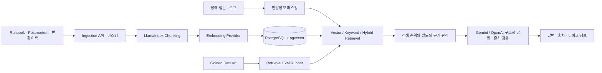

# 아키텍처

## 설계 원칙

- 생성 전에 검색 품질을 측정한다.
- 생성 답변의 각 주장에 검색된 청크 ID를 요구하고 실제 ID인지 검증한다.
- 검색 근거가 부족하면 답변을 거절한다.
- 프롬프트, 모델, 검색 점수와 지연시간을 추적한다.
- 새 문서와 질문은 저장/외부 전송 전에 마스킹하며, 새 Trace에 원본 질문을 보존하지 않는다.
- 모델별 임베딩 공간을 구분하고 설정이 달라지면 재색인을 요구한다.

## 기술 선택

- FastAPI: 문서 수집, 검색, 답변, 평가 API
- Next.js: 채팅, 출처, RAG 디버그 화면
- PostgreSQL + pgvector: 운영 데이터와 임베딩 통합 저장
- LlamaIndex Core: 문장 단위 청킹
- Gemini generateContent / OpenAI Responses API: 구조화 답변과 출처 ID 생성
- Gemini / OpenAI Embeddings API: 의미 기반 검색 벡터 생성

## 데이터와 평가

`documents`와 `document_chunks`에 문서 및 모델 식별 정보를 저장하고, `retrieval_traces`에 마스킹한 질문, 검색 후보, 답변 생성에 제공한 청크와 진단 정보를 기록한다. 기존 DB에는 시작 시 `diagnostics` JSONB 열을 추가하는 호환 처리를 수행한다. 프로덕션용 버전 관리 마이그레이션은 후속 범위다.

평가는 채팅과 동일한 `evidence_chunks` 판정을 사용한다. 검색 순위 점수와 답변 허용 기준은 별개이며, 판정 통과와 인용 ID 유효성은 의미적 정답의 증명이 아니다. 자동 평가의 범위와 실패는 [Gemini 검색 실험](retrieval-experiment-v2-gemini-budget.md)에 기록한다.

실제 생성 모델은 `gemini-3.5-flash-lite`, 의미 임베딩은 `gemini-embedding-001` 1536차원이다. 역할·설정·검증 범위는 [모델 상세](models.md)에 기록한다.
