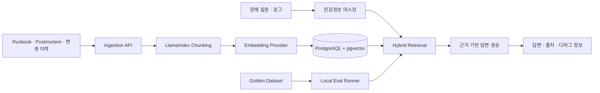

# 아키텍처

## 설계 원칙

- 생성 전에 검색 품질을 측정한다.
- 모든 답변은 검색된 청크와 연결한다.
- 검색 근거가 부족하면 답변을 거절한다.
- 프롬프트, 모델, 검색 점수와 지연시간을 추적한다.
- OpenAI API 키가 없어도 로컬 개발 모드에서 UI와 검색 흐름을 검증할 수 있다.

## 기술 선택

- FastAPI: 문서 수집, 검색, 답변, 평가 API
- Next.js: 채팅, 출처, RAG 디버그 화면
- PostgreSQL + pgvector: 운영 데이터와 임베딩 통합 저장
- LlamaIndex Core: 문장 단위 청킹
- OpenAI Responses API: 근거 기반 답변 생성
- OpenAI Embeddings API: 의미 기반 검색 벡터 생성

