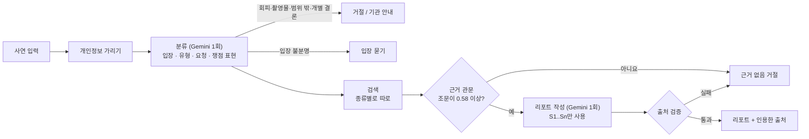

# Lawg 동작 방식

사연 하나가 리포트가 되기까지의 과정과, 그렇게 만든 이유를 적었습니다. 숫자의 근거는 [실험 결과](experiments.md)에 있습니다.



리포트 1건에 생성 모델 호출 2번(분류, 작성)과 질문 임베딩 1번이 듭니다. 근거가 없거나 거절할 사연은 작성 호출 없이 끝납니다.

## 1. 근거 자료와 색인

| 종류 | 개수 | 본문 | 출처 |
| --- | ---: | --- | --- |
| 조문 (`statute`) | 78 | 조문 원문 그대로, 시행일 포함 | 국가법령정보센터 |
| 판례 (`precedent`) | 35 | 판결요지(없으면 판시사항). 전원합의체는 다수의견만 | 국가법령정보센터 |
| 양형기준 (`sentencing`) | 7 | 형량표의 권고 범위와 적용 범위 문장 | 『2026 양형기준』 |
| 해설 (`guide`) | 25 | 원문 발췌. 다른 기관 자료와 옛 법정형 문단은 뺌 | 법제처 찾기 쉬운 생활법령정보 |
| 신고·상담처 (`contact`) | 3 | ECRM, 대한법률구조공단 132, 디지털성범죄 1366 | 각 기관 누리집 |

- 파일 하나가 자료 하나입니다(`backend/data/sources/*.md`). 앞머리(front matter)에 제목, 종류, 시행일·선고일, 사건 유형(`categories`), 원문 URL을 적습니다.
- **자료 1개 = 청크 1개**로 색인합니다. 조문을 쪼개지 않아야 인용이 항상 조문 전체를 가리킵니다.
- 본문을 `gemini-embedding-001`(1536차원)로 임베딩해 PostgreSQL pgvector에 저장합니다. 제목과 사건번호는 임베딩하지 않습니다.
- 색인마다 임베딩 모델과 차원을 기록하고, 검색할 때 지금 설정과 다르면 오류를 냅니다. 다른 벡터 공간을 섞어 비교하지 않기 위해서입니다.
- 다시 색인할 때 폴더에서 지운 파일의 문서는 DB에서도 지웁니다. 검토에서 뺀 조문이 배포된 DB에 남아 계속 인용되지 않게 하려는 것입니다.
- 원문은 `scripts/fetch_statutes.py`, `scripts/fetch_precedents.py`로 받습니다(공개 페이지 수집, 법령 Open API 승인 후 교체 예정).

## 2. 개인정보 가리기

사연은 저장하거나 모델에 보내기 전에 정규식으로 가립니다(`app/services/redaction.py`).

- 전화번호, 계좌번호, 주민등록번호, 이메일, IP, API 키
- 이름은 "이름은 OOO", "OOO 씨/님"처럼 쓴 경우만. 그 밖의 이름은 못 가립니다.
- 조회 기록(trace)에는 가린 사연만 남습니다.

## 3. 분류

Gemini를 한 번 불러 JSON 스키마로 받습니다.

- **입장:** 피해자, 가해자, 주변인, 불분명. 주어가 생략된 문장은 동사의 주체로 판단합니다("아이템 판다고 하고 돈만 받고 차단했어요"는 가해자). 화면에서 고칠 수 있습니다.
- **유형:** 거래 사기, 모욕, 명예훼손, 통매음, 계정 도용, 협박·스토킹, 범위 밖
- **요청:** 리포트, 회피·은폐, 개별 결론, 전문 기관 안내
- **쟁점 표현:** 사연의 말을 법률 쟁점으로 바꾼 것("먹튀" → "거래 사기"). 검색어에 붙입니다.

검색 전에 거절할 것은 여기서 거절합니다. 회피·은폐 요청, 촬영물 유포(1366 안내), 범위 밖, 사건 설명 없이 형량만 묻는 질문이 이에 해당합니다. 입장을 알 수 없으면 검색하지 않고 입장을 묻습니다.

## 4. 검색

```
검색어 = 가린 사연 + 쟁점 표현   →   임베딩 1번   →   종류별로 코사인 유사도 상위 N개
조문 8 · 판례 2 · 양형기준 1 · 해설 3 · 신고·상담처 3
```

- **종류별로 따로 찾습니다.** 자료를 19개에서 148개로 늘렸을 때 한 순위로 섞어 찾자 정답 조문 재현율이 0.93에서 0.19로 떨어졌습니다. 평소 말투로 쓴 판례와 해설이 짧은 조문보다 사연과 더 비슷하게 잡혔기 때문입니다.
- **양형기준과 신고·상담처는 사건 유형으로 먼저 거릅니다.** 형량표와 신고처는 범죄마다 다르고, 해설이 신고처보다 높은 순위를 받아 신고처 안내가 빠졌기 때문입니다. 조문과 해설에는 유형 필터가 효과가 없어서 쓰지 않습니다.
- **기본은 벡터 검색입니다.** 키워드 검색(PostgreSQL 전문 검색)과 하이브리드도 있지만, 키워드는 한국어 조사를 떼지 못해 거의 맞지 않았습니다. 하이브리드는 「형법」을 인용하는 절차 조문을 끌어올려 벡터보다 낮았습니다. `REPORT_RETRIEVAL_MODE`로 바꿀 수 있습니다.

## 5. 근거 관문

- 검색 결과 중 **조문**이 하나라도 유사도 0.58 이상이어야 리포트를 씁니다. 아니면 모델을 부르지 않고 "근거 없음"으로 거절합니다.
- 0.58은 dev 답변 대상 64건이 모두 조문을 남기는 가장 높은 값입니다.
- 신고·상담처는 이미 유형으로 골랐으므로 관문을 거치지 않습니다.
- 범위 안이지만 맞는 조문이 없는 사연은 임계값으로 가를 수 없었습니다(실험 결과 참고). 이런 사연은 작성 단계에서 모델이 `answerable=false`로 거절합니다.

## 6. 리포트 작성과 출처 검증

모델에는 사연, 입장, 유형, 쟁점 표현과 근거 자료(S1..Sn: 종류, 제목, 본문)만 보냅니다. 모델은 쉬운 풀이와 정리만 쓰고, 조문 원문은 화면이 색인된 문서에서 직접 보여 줍니다.

작성 결과는 다음 규칙으로 검사합니다(`_validated`).

| 규칙 | 어기면 |
| --- | --- |
| 모델이 `answerable=false` | 근거 없음 거절 |
| 없는 S 번호 인용 | 근거 없음 거절 |
| 숫자가 든 처벌 범위 문장에 출처가 없음 | 근거 없음 거절 |
| "관련 조문" 칸이 조문·판례가 아닌 해설·양형기준을 인용 | 그 항목만 뺌 |
| "관련 조문" 한 칸에 "S9, S10"처럼 여러 번호 | 첫 조문·판례 번호만 남김 |
| 처벌 범위·할 일의 출처 목록 한 칸에 "S1, S15" | 번호를 나눠 읽음 |
| 남은 조문·판례가 없음 | 근거 없음 거절 |

- 응답에는 리포트가 **인용한 출처만** 남깁니다. 검색된 나머지는 조회 기록에만 남습니다.
- 양형기준을 인용하면 화면에 고정 문구를 붙입니다(공소 제기 때 19세 이상 피고인에게만 적용, 미수범 제외, 스토킹 외 벌금형 제외). 이 문구는 모델이 쓰지 않습니다.
- 지시문에서 금지하는 것: 처벌 회피·증거 인멸 방법, 근거 자료에 없는 연락처·숫자, 게임·중고 거래 사기에 계좌 지급정지·환급 안내(통신사기피해환급법 대상이 아님).

## 7. 모델 호출과 실패 처리

- 생성: `gemini-3.5-flash-lite`, temperature 0, JSON 스키마 응답
  - 과부하·한도(429·5xx)면 1번 다시 시도하고, 그래도 안 되면 `gemini-3.1-flash-lite`로 1번 바꿔 시도합니다.
  - 스키마에 안 맞는 JSON이면 1번 다시 요청합니다.
- 임베딩: 다시 시도만 하고 모델은 바꾸지 않습니다(벡터 공간이 달라지므로).
- 화면에 보이는 상태
  - 콘텐츠 차단: 422(표현을 바꿔 달라는 안내)
  - 과부하·한도 초과: 503(잠시 뒤 다시)
  - 설정 오류: 502(일반 문구)
- 방문자마다 10분에 리포트 10건까지 만들 수 있습니다. 관리자 API(색인, 평가, 조회 기록)는 `ADMIN_TOKEN`이 있어야 합니다.

## 8. 알려진 한계

- **사건번호·제목으로는 판례를 못 찾습니다.** 판결요지 본문만 임베딩했기 때문입니다.
- **결론이 반대인 판례 쌍이 함께 나온다는 보장이 없습니다.** 판례 자리가 2개이고, 사연과 비슷한 순서로만 뽑습니다(예: 게임 채팅 통매음 2022도10688, 2023도7199).
- **오프라인 사건이 리포트로 처리되기도 합니다.** 분류 지시에 오프라인은 범위 밖이라고 적었지만, dev에서 이웃의 소문, 집 앞 협박 2건이 리포트로 처리됐습니다.
- **이름은 정해진 형식으로 쓴 것만 가립니다.**
- **평가셋은 초안입니다.** 질문과 정답 조문을 Claude가 썼고 소유자 검토 전입니다.
