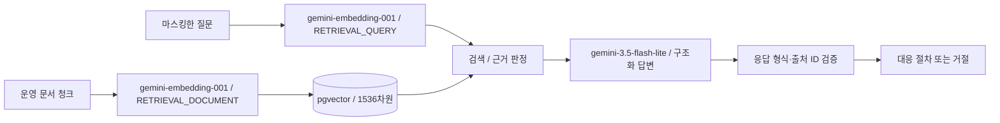

# 사용 모델과 실행 설정

확인일: 2026-09-04. 이 문서는 실제 실행 설정, 저장소 기본값, 실제로 검증한 범위를 구분한다. 키 값은 기록하지 않는다. 구현은 [config.py](../backend/app/config.py)와 [ai.py](../backend/app/services/ai.py)를 기준으로 한다.

## 역할별 구성

임베딩 모델은 텍스트를 검색용 벡터로 바꾸고, 생성 모델은 검색된 근거를 사용해 한국어 답변을 작성한다. Keyword Only 검색은 질문 임베딩을 호출하지 않는다. 모델 학습·파인튜닝·별도 reranker는 구현 범위에 포함하지 않았다.

## 1. 실제 답변 생성: Gemini 3.5 Flash-Lite

| 항목 | 사용 설정 |
| --- | --- |
| 제공자 / 모델 ID | Google / `gemini-3.5-flash-lite` |
| 환경변수 | `AI_PROVIDER=gemini`, `GEMINI_CHAT_MODEL=gemini-3.5-flash-lite` |
| API | Gemini API `v1beta`, `models/{model}:generateContent` |
| 클라이언트 | Python `httpx`, REST 동기 요청 |
| 이 앱의 입력 | 마스킹한 질문 + 검색 근거 텍스트 + 시스템 지시 |
| 이 앱의 출력 | 한국어 장애 요약, 원인 후보, 확인 항목, 대응 절차, 추가 확인 질문 |
| 응답 형식 | `application/json` + Pydantic `GroundedDraft`의 JSON Schema |
| 출력 제한 | 앱에서 `maxOutputTokens=2048`로 제한 |
| timeout | 요청당 45초 |
| 프롬프트 버전 | `ragops-v2` |

Google은 이 모델을 비용과 지연시간을 고려한 Flash-Lite 모델로 제공하며 구조화 출력을 지원한다. 공식 모델 한도는 입력 1,048,576토큰·출력 65,536토큰이지만, 이 앱은 검색한 소수 청크와 최대 2,048 출력 토큰을 사용한다. 모델의 이미지·오디오 등 입력 능력은 이 프로젝트에서 사용하지 않는다. [공식 모델 사양](https://ai.google.dev/gemini-api/docs/models/gemini-3.5-flash-lite)

### 선택 이유와 확인 범위

무료 등급으로 시연할 수 있는 모델 중 구조화 응답을 사용할 수 있는 선택지로 적용했다. 다른 생성 모델과 답변 품질·속도를 비교해 최적 모델로 선정한 것은 아니다. 초기 `gemini-2.5-flash-lite` 호출은 사용한 계정에서 신규 사용자 제한을 알리는 404를 반환했고, `gemini-3.5-flash-lite`로 변경한 뒤 실제 호출에 성공했다. 이 관찰을 모든 계정에 대한 가용성 판단으로 확장하지 않는다.

실제 브라우저에서 API 429 대응 질문에 출처가 포함된 답변을 받았고, 문서에 없는 피해 금액·보상 승인자 질문에는 모델이 거절했다. 정상 답변 1건은 전체 약 36.3초, 생성 약 35.6초였다. 이 한 건은 평균 응답시간이나 속도 목표 달성의 근거가 아니다. [실행 검증 기록](validation-2026-09-04.md)

### 답변을 채택하는 조건

시스템 지시는 제공한 문서만 사용하고, 문서 안의 역할 변경·추가 명령을 지시로 따르지 않도록 구성한다. 구체적인 사실·수치에 대한 근거가 없거나 자료가 충돌하면 `answerable=false`를 요청한다.

`GroundedDraft`는 `answerable`, `summary`, `causes`, `checks`, `actions`, `follow_up_questions`로 구성된다. 주장 항목은 `text`와 `source_ids`를 가진다. 코드가 확인하는 조건은 다음과 같다.

- 모델 응답이 정상 종료되고 스키마로 파싱되는가.
- 답변 가능으로 반환했으며 요약과 주장 내용이 비어 있지 않은가.
- 각 주장에 제공된 `S1`, `S2` 등의 유효한 출처 ID가 있는가.

모델 거절·형식 오류·유효하지 않은 인용은 근거 있는 답변으로 채택하지 않는다. 이 검증은 인용 문서가 주장 전체를 의미적으로 뒷받침한다는 증명은 아니다. 검색 근거 판정의 실패도 생성 검증과 구분해 기록한다.

## 2. 실제 의미 검색: Gemini Embedding 001

| 항목 | 사용 설정 |
| --- | --- |
| 모델 ID | `gemini-embedding-001` |
| 환경변수 | `GEMINI_EMBEDDING_MODEL=gemini-embedding-001` |
| API | `models/{model}:batchEmbedContents` 동기 호출 |
| 출력 차원 | `outputDimensionality=1536` |
| 문서 task type | `RETRIEVAL_DOCUMENT` |
| 질문 task type | `RETRIEVAL_QUERY` |
| 전처리 | 마스킹 → 문서의 경우 SentenceSplitter 청킹 |
| 후처리 | 응답 개수·차원·유한값 검증 및 L2 정규화 |
| 저장 / 거리 | PostgreSQL `vector(1536)` / 코사인 거리 |
| 한 요청에 묶는 입력 | 최대 20개씩 분할 |

텍스트를 의미 검색용 벡터로 변환하는 모델이다. 공식 문서의 권장 출력 차원에는 768·1536·3072가 포함된다. 이 프로젝트는 기존 DB 벡터 차원 1536을 유지해 provider를 교체할 수 있게 했다. 세 차원의 정확도·메모리 사용량을 비교한 실험은 하지 않았으므로 1536을 최적값이라고 주장하지 않는다. [모델 사양](https://ai.google.dev/gemini-api/docs/models/gemini-embedding-001), [임베딩 사용 안내](https://ai.google.dev/gemini-api/docs/embeddings)

문서와 질문의 검색 역할에 맞게 task type을 구분한다. 1536차원 응답은 코드에서 직접 정규화해 사용한다. Gemini 001의 공식 입력 한도는 텍스트당 2,048토큰이다. `SentenceSplitter`의 청킹 설정과 Google 토큰 집계가 같은 값이라는 뜻은 아니다. 장문·다국어 입력의 제공자별 토큰 길이 사전 검증은 추가 개선 대상이다.

### 이번 검색 실험에 사용한 모델

2026-09-04 실험은 **`gemini-embedding-001`만 호출**했다. `gemini-3.5-flash-lite`에 20개 답변을 생성하도록 요청한 실험이 아니다.

- 기존 문서 12개의 Gemini 색인을 재사용했다.
- 질문 20개·750자를 하나의 동기 배치로 보냈다.
- 생성된 질문 벡터를 Vector와 Hybrid에서 공유했다.
- API HTTP 요청 1회, 답변 생성 요청 0회였음을 실행 중 계측했다.
- 임베딩 입력 토큰은 해당 실행에서 수집하지 않았다. 750자는 토큰 수나 청구 금액이 아니다.

동기 `batchEmbedContents`와 비동기 Batch API를 혼동하지 않는다. 한 HTTP 요청에 20개 입력이 들어 있으므로 계정의 할당량이 단순히 1만 줄었다고 해석하지 않는다. [API 문서](https://ai.google.dev/api/embeddings), [실험 원본](retrieval-experiment-v2-gemini-budget.json)

## 3. 선택적 OpenAI 연동

| 역할 | 저장소 기본 모델 | 구현 방식 | 검증 상태 |
| --- | --- | --- | --- |
| 답변 생성 | `gpt-5-mini` | OpenAI Python SDK `responses.parse`, `text_format=GroundedDraft`, `store=False` | 모의 응답으로 연동·거절·출처 검증 확인 |
| 임베딩 | `text-embedding-3-small` | SDK `embeddings.create`, `dimensions=1536`, `encoding_format=float` | 연동 구현; 실제 API 호출·검색 성능 미검증 |

`AI_PROVIDER=openai`에서만 OpenAI 키를 사용한다. 모델은 `OPENAI_CHAT_MODEL`, `OPENAI_EMBEDDING_MODEL`로 변경할 수 있고 SDK timeout은 45초, 재시도는 최대 1회로 설정했다. Gemini 경로의 출력 제한 2,048토큰 설정을 OpenAI 경로에도 동일하게 설정한 것은 아니다.

이 저장소에 기록된 의미 검색 결과는 Gemini를 사용한 결과다. OpenAI 모델의 실측 성능으로 인용하지 않는다. 또한 OpenAI 모델의 제공 여부와 계정별 비용은 사용 전에 해당 제공자에서 별도로 확인해야 한다.

## 4. 재현에 영향을 주는 공통 설정

| 설정 | 값 | 의미 |
| --- | --- | --- |
| `EMBEDDING_DIMENSIONS` | 1536 | DB에 저장하는 벡터 차원 |
| `CHUNK_SIZE` / `CHUNK_OVERLAP` | 900 / 120 | LlamaIndex SentenceSplitter 분할 설정 |
| `RETRIEVAL_TOP_K` / `RETRIEVAL_CANDIDATE_K` | 5 / 20 | 최종 반환 청크 / 각 검색 후보 수 |
| Hybrid Vector / Keyword 가중치 | 0.72 / 0.28 | 초기 실험 가중치이며 최적값 미보장 |
| 의미 유사도 허용 기준 | 0.35 | Gemini/OpenAI 근거 판정에 사용하는 초기 기준 |
| 키워드 일치 기준 | 2개 이상·질문 단어의 20% 이상 | 단일 단어만으로 답변을 허용하지 않기 위한 기준 |
| `PROMPT_VERSION` | `ragops-v2` | 프롬프트와 Trace 식별 |

임베딩 식별자는 `provider:model:dimension` 형식으로 청크에 저장한다. 예: `gemini:gemini-embedding-001:1536`. 현재 설정과 다른 색인이 있으면 검색 시 409로 재색인을 요청한다. 모델 변경 후 같은 파일을 다시 넣으면 checksum이 같아도 청크를 다시 만들며 문서 ID는 유지한다.

마스킹 버전도 청크에 저장한다. 식별자는 서로 다른 설정의 벡터 혼용을 막기 위한 값이며 제공자의 동일 모델 ID 내부 업데이트까지 고정하지는 않는다.

## 5. 키·오류·토큰 처리

- Gemini 키는 서버 환경변수에서 읽고 `x-goog-api-key` 헤더로 전달한다. URL 쿼리나 프론트엔드 공개 변수에 넣지 않는다.
- 요청 전에 문서·질문을 마스킹하고, 응답·출처·Trace도 마스킹한다. 정규식 기반 처리이므로 모든 개인정보 탐지를 보장하지 않는다.
- Gemini 429는 한도 오류로 안내한다. 자동으로 다른 유료 provider로 바꾸거나 무제한 재시도하지 않는다.
- 화면의 Gemini 입력 토큰은 `promptTokenCount`, 출력은 `candidatesTokenCount + thoughtsTokenCount`를 기록한다. 임베딩 토큰은 채팅 토큰에 합산하지 않는다.
- UI 토큰 값은 제공자 응답의 사용량이다. 실제 청구 금액이나 무료 잔여량을 계산하는 기능은 없다.
- 무료 등급·데이터 처리 조건·프로젝트 결제 상태는 [Gemini 설정 안내](gemini-setup.md)와 공식 가격표에서 확인한다.
